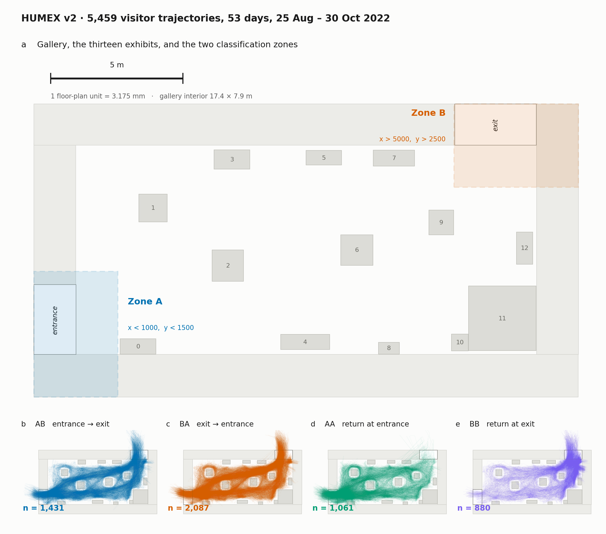

# HUMEX v2 — visitor trajectories in a museum gallery

**Browse:** [humex-data.streamlit.app](https://humex-data.streamlit.app) · **Data:** [github.com/wisions/humex_data](https://github.com/wisions/humex_data) · **Project page:** [osf.io/7f5du](https://osf.io/7f5du)

## Summary

HUMEX v2 contains **5,459 visitor trajectories** recorded in a single gallery of a museum exhibition space over **53 days, 25 August to 30 October 2022** — about **15.8 million position samples** in all. Each trajectory is one visitor's path across the room, sampled at 30 Hz as time and two-dimensional floor position, stored as a plain CSV. Ten overhead cameras covered the gallery; positions were recovered by pose estimation, projected into a shared floor-plane frame, and merged across cameras into continuous visitor paths. Trajectories are labeled by where the visitor entered and left.

The dataset is intended for work on route choice, dwell, spatial occupancy, sequential structure and visitor flow. Everything needed to use it is in this report.



**Figure 1.** *(a)* The gallery: thirteen exhibit installations (0–12), the surrounding walls, and the entrance and exit at opposite corners. Shading marks the two zones used to classify trajectories, clipped here to the gallery footprint. *(b–e)* All 5,459 trajectories, drawn by class. Panels b–e use a wider frame than panel a so that positions reconstructed outside the nominal floor plan stay visible.

## What you get

| File | Size | Contents |
|---|---:|---|
| `humex_trajectories_202208.zip` | 14.6 MB | 617 trajectories, 7 days, 2022-08-25 → 08-31 |
| `humex_trajectories_202209.zip` | 78.4 MB | 3,323 trajectories, 28 days, 2022-09-01 → 09-30 |
| `humex_trajectories_202210.zip` | 41.4 MB | 1,519 trajectories, 18 days, 2022-10-01 → 10-30 |
| `trajectory_index.csv` | 0.5 MB | one row per trajectory: day, id, class, duration, samples, extent, path, net displacement |
| `recording_start.csv` | 2 KB | per day, the clock time at which `time_s = 0` |
| `floor_overlay.png` | 98 KB | gallery floor plan, 6480 × 3496 px |
| `floor_overlay_labels.csv` | 1.5 KB | 19 named regions with bounding boxes |

Trajectories are archived **one zip per calendar month**, which keeps every file under the 100 MB single-file limit and makes later months straightforward to add. **Each archive is an independent, ordinary zip, not a binary fragment** — unzip whichever months you need; there is no reassembly step and no special tool. Filenames inside carry the full date, so months can be unpacked into one directory without collision.

```bash
unzip -q 'humex_trajectories_2022*.zip' -d tracks/
ls tracks/ | wc -l        # 5459
```

## Data format

One CSV per visitor, three columns, uniformly sampled at 30 Hz with no gaps:

```csv
time_s,x,y
27340.667,815.98,779.65
27340.700,816.52,780.75
```

**Filenames** are `YYYYMMDD_track_NNNNN_TT.csv` — recording date, trajectory number, entry/exit class. The number is a **per-day index**, so combine it with the date to key a trajectory uniquely; the same number recurs on other days for other visitors.

**Coordinates** are pixels of `floor_overlay.png`, mapping 1:1. The image is 6480 × 3496, the origin is the **bottom-left** corner, and **y increases upward**. **One unit = 3.175 mm**, so multiply by 0.003175 for meters. The gallery interior measures about 17.4 × 7.9 m; the full floor plan including walls is about 20.6 × 11.1 m.

**Time.** `time_s` is **seconds since that day's recording began**, not since midnight. Recording started between 09:59 and 11:02 depending on the day, so `time_s = 0` is a different clock time on different days. To get wall-clock time, add the day's offset from `recording_start.csv`:

```python
start = pd.read_csv("recording_start.csv").set_index("day")["recording_start_s"]
clock = track["time_s"] + start[day]      # seconds since midnight, local
```

Comparing time of day across days without this correction introduces an offset of up to an hour.

**Classes.** `TT` records the zone where the trajectory began and ended. **Zone A** is the entrance corner (*x* < 1000, *y* < 1500), **Zone B** the exit corner (*x* > 5000, *y* > 2500). Both lie inside the gallery; the codes describe which **end of the room**, not inside versus outside.

| Code | Meaning |
|---|---|
| `AB` | entrance → exit, a full crossing |
| `BA` | exit → entrance, the reverse crossing |
| `AA` | entered and returned at the entrance end |
| `BB` | entered and returned at the exit end |

**Spatial metadata.** `floor_overlay_labels.csv` gives `name, x, y, width, height` for thirteen exhibit rectangles `exh0`–`exh12`, four wall bands, and `entrance` and `exit`.

## Composition

| | Trajectories | Share |
|---|---:|---:|
| `BA` exit → entrance | 2,087 | 38.2 % |
| `AB` entrance → exit | 1,431 | 26.2 % |
| `AA` return at entrance | 1,061 | 19.4 % |
| `BB` return at exit | 880 | 16.1 % |
| **Total** | **5,459** | |

Full crossings make up 64.4 % of the set. Across 53 recording days there are a median of 108 trajectories per day, ranging from 2 on the quietest to 254 on the busiest; the gallery was closed on Wednesdays, which accounts for the thinnest days.

| Per trajectory | |
|---|---:|
| Duration | median 54 s, mean 97 s, 95th percentile 323 s, maximum 1,829 s |
| Samples | median 1,620 |
| Path length | median 78 m |
| Walking speed | median 1.47 m/s |

Minimum duration is 20 s by construction. Trajectories are retained on two bases: the 3,518 full crossings (`AB`, `BA`) were selected by expert review, and the 1,941 excursions (`AA`, `BB`) by explicit criteria — spatial extent ≥ 2.5 m, path length ≥ 20 m, duration ≥ 20 s, peak speed ≤ 8 m/s, and not a stationary track inside a doorway.

## How the trajectories were produced

Ten overhead cameras covered the gallery with partially overlapping fields of view. No camera saw the whole room, so a visitor crossing it was observed by several in sequence. Camera clocks were synchronized to within 0.33 s. Camera hardware specifications were not recorded.

Each stream was processed with YOLO11-large pose tracking, giving 17 body keypoints per detected person and a camera-local identity across consecutive frames. Floor position is the mean of the two ankle keypoints, kept only where both exceeded a confidence of 0.8. Lens distortion was removed with a single undistortion shared by all cameras — OpenCV's fisheye model, focal length 1200 px, principal point at the image center, distortion coefficients zero — and each image plane was mapped to the common floor frame by a 3 × 3 homography fitted to surveyed floor points.

Camera-local fragments were resampled onto a uniform 30 Hz grid by confidence-weighted interpolation. For each of the 41 camera pairs sharing a field of view, fragments were compared inside the shared-visibility polygon, matched by nearest timestamp within 67 ms, and scored by mean separation. Any pair separated by less than 0.48 m was joined; each connected component was taken as one visitor, and its fragments merged by averaging positions at coincident times. Within those polygons, two cameras observing the same visitor agree to a median of 0.17–0.22 m.

Merged trajectories were then labeled by their start and end zones and written as CSV.

## Notes for use

**Convert units and time before anything else.** Multiply coordinates by 3.175 mm for meters; add the day's offset from `recording_start.csv` for wall-clock time. Both are easy to miss and both scale results.

**Positions extend past the floor plan.** Coordinates run from *x* = −837 to 6,392 and *y* = 208 to 5,323, against a nominal 6480 × 3496 plan. About 2 % of samples fall outside the plan, mostly near walls and at the margins of camera coverage, where the homography extrapolates. Plots with axes fixed to the overlay extent will silently hide them.

**Samples mix observed and interpolated positions.** The released CSVs do not distinguish the two.

**Expect occasional discontinuities.** Merged paths can jump where averaging transfers between camera fragments. Most gross cases were removed; a peak-speed check around 3 m/s flags most of the rest.

**The set is selected, not exhaustive.** It is not every visitor who entered the gallery, and class proportions reflect the selection described above rather than visitor behavior. Base-rate questions need the full export, not this file.

**Nothing identifies anyone.** Only anonymous floor positions were retained; no images, faces or identities are in the dataset or were kept at any stage.

## Availability

The dataset is released under **CC-BY 4.0** and lives in three places, each linking to the other two:

| Where | Link | What is there |
|---|---|---|
| Repository | [github.com/wisions/humex_data](https://github.com/wisions/humex_data) | trajectory archives, floor plan, index, browser source, this report |
| Project page | [osf.io/7f5du](https://osf.io/7f5du) | landing page, wiki, mirror of the archives |
| Interactive browser | [humex-data.streamlit.app](https://humex-data.streamlit.app) | explore trajectories on the floor plan, nothing to install |

Trajectories are published one archive per calendar month; further months are added as the same kind of archive alongside these, so the layout does not change as coverage grows.

Processing code and intermediate products are not part of this release. Questions and corrections go through the OSF project page.
